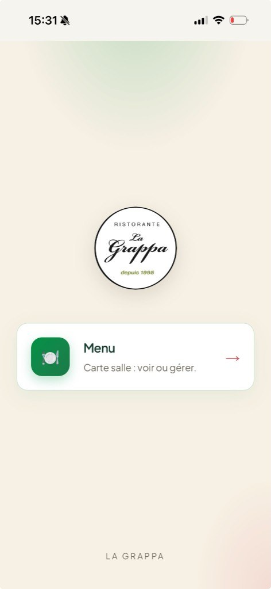
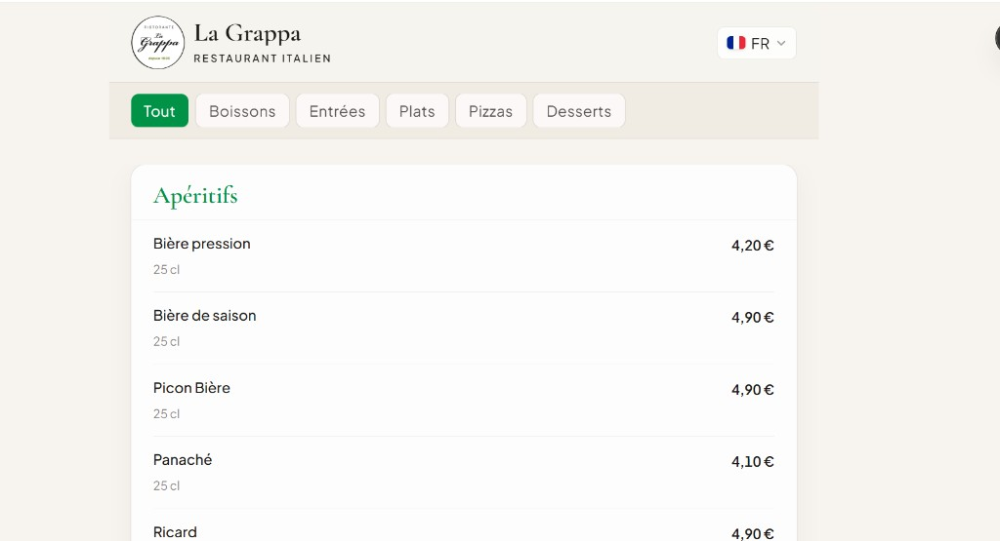
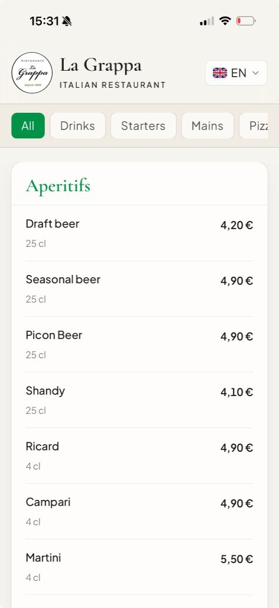
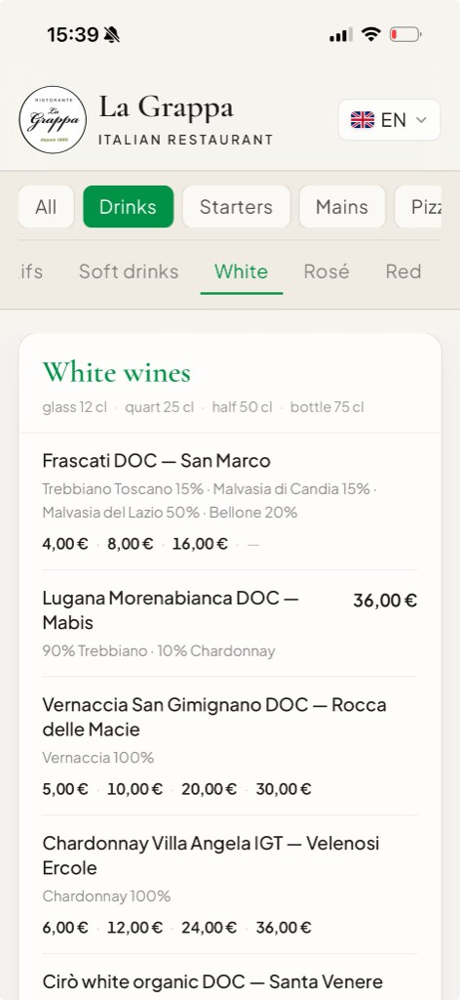
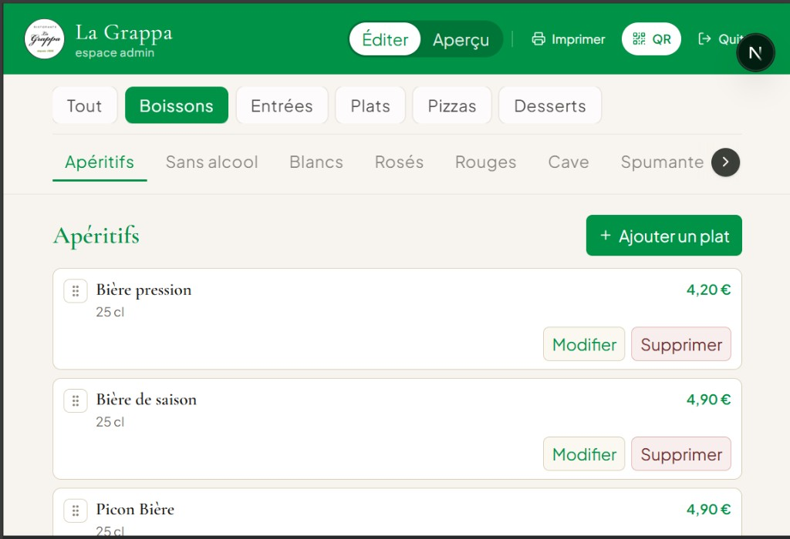
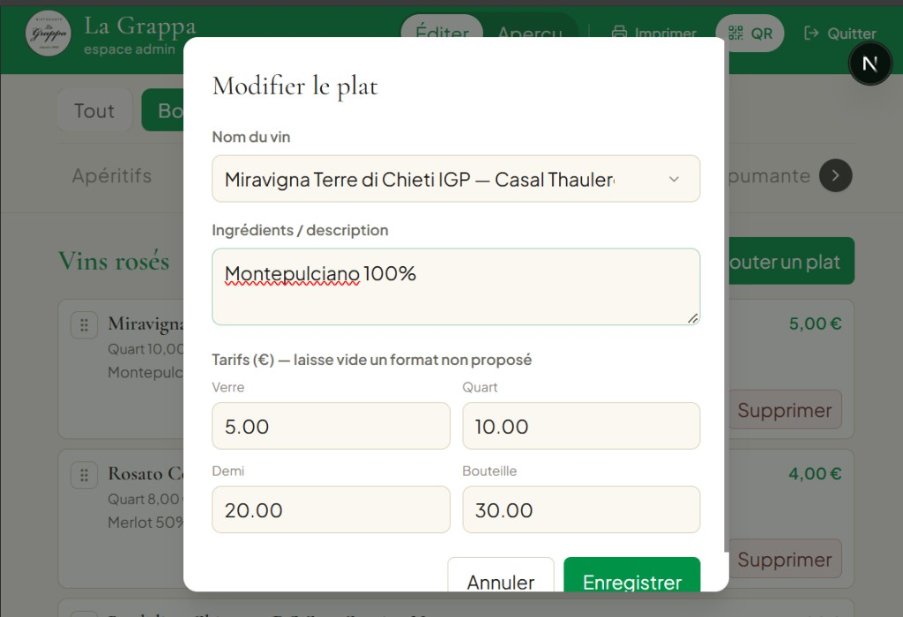
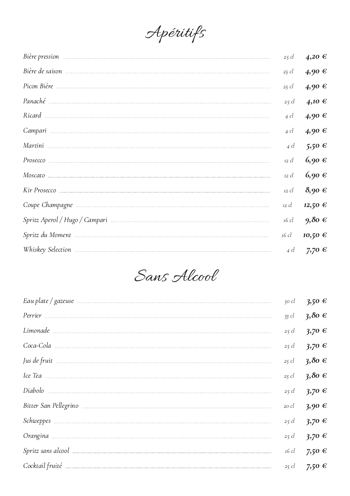

# La Grappa — carte digitale

Utilisé **en production** par le restaurant La Grappa : la carte n’est plus seulement papier, le gérant la met à jour au téléphone, les clients la lisent au **QR code**.

Une seule carte, un seul rôle (pas d’écran suggestions en salle — contrairement à Félicità).

## Ce que ça fait

| Qui | Quoi |
| --- | --- |
| Clients | Menu digital, **FR / EN / DE / IT**, langue mémorisée sur l’appareil |
| Clients | Vins au verre, au quart, au demi ou à la bouteille ; pictos (piment, bio…) |
| Gérant | Plats, prix, ordre par glisser-déposer ; retrouver un plat retiré en tapant son nom |
| Gérant | Impression paginée + QR — protégé par un PIN |

Les traductions viennent d’un **dictionnaire** (carte actuelle). Un plat nouveau reste en français tant qu’on n’ajoute pas la ligne de traduction.

## Stack

**Next.js 16** · React 19 · TypeScript · Tailwind CSS 4 · Prisma · PostgreSQL · Vercel

Pages : `/menu` (clients) · `/admin/menu` (gérant)

## Aperçu

Page d’accueil : voir la carte ou la gérer.

Carte lue par les clients, avec la langue et les familles de plats.

La même carte sur téléphone, en anglais.

Les vins sur téléphone : verre, quart, demi et bouteille.

Espace du gérant : édition, aperçu, impression et QR.

Tarifs d’un vin : verre, quart, demi, bouteille.

Première page de la carte imprimée, tirée du PDF (7 pages).

## Sécurité (résumé)

PIN gérant. Session signée (HMAC), cookie `httpOnly`. Le PIN n’est pas dans le navigateur.

## Auteur

**Hamid Bersi** — conception, développement, mise en production et suivi.
